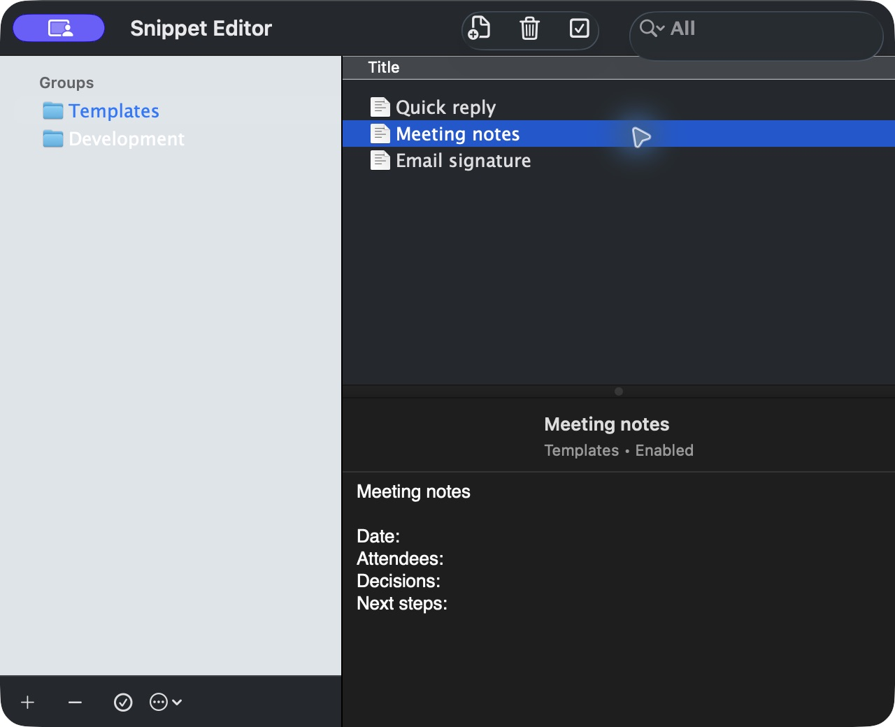
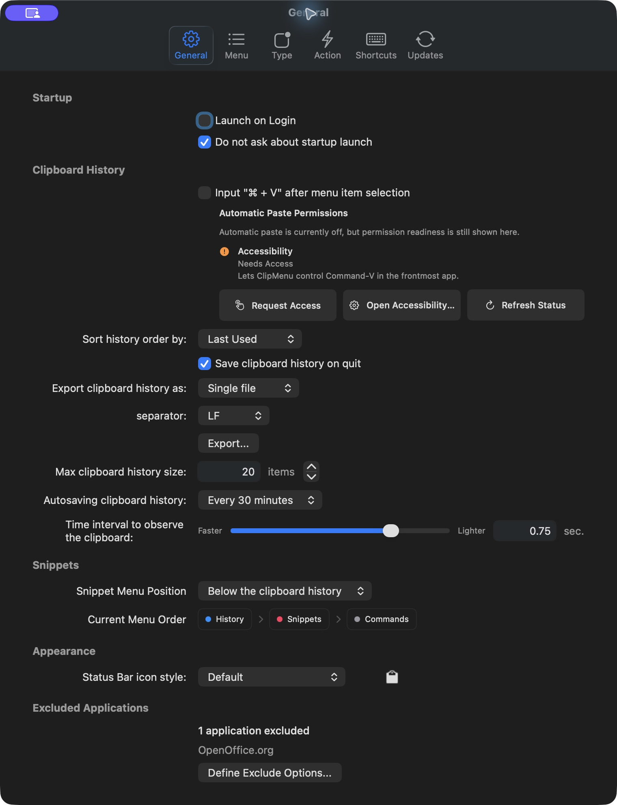
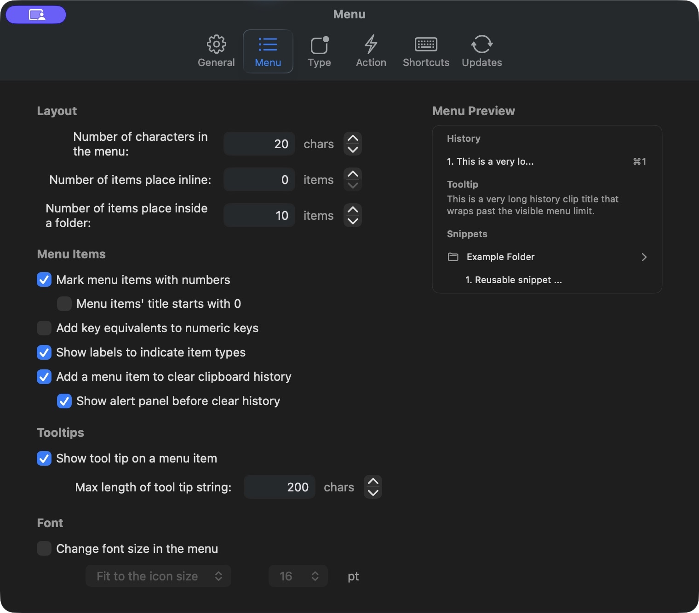
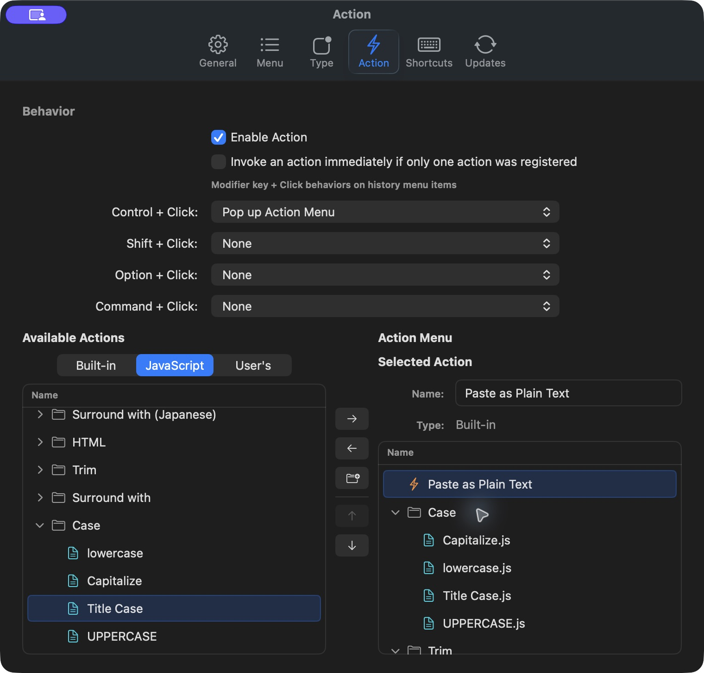

# ClipMenu

A clipboard manager that lives in the macOS menu bar. This Swift port brings the original ClipMenu workflow to native SwiftUI and AppKit windows on **macOS 12 or later**, with English and Japanese interfaces. Packaged Release builds are universal, supporting both Apple silicon and Intel Macs.



## Features

- Reuse clipboard history containing text, rich text, images, URLs, PDFs, and copied file paths. Configure the history limit, ordering, and autosave behavior.
- Organize reusable text snippets in folders, search and edit them, and import or export a snippet library.
- Transform clips and snippets with built-in actions and bundled or custom JavaScript actions, including case conversion, trimming, encoding, and Japanese text conversion.
- Open menus with global keyboard shortcuts, customize menu appearance and numeric shortcuts, and paste into the frontmost app.
- Choose which clipboard types to capture, exclude applications from recording, and export text history to one or more files.
- Use native preferences that resize immediately to each pane. Tall panes fit the available screen height and scroll with a thin indicator that fades when idle. Action lists scroll independently.

## Get started

See [GitHub Releases](https://github.com/frank4565/ClipMenu/releases) for packaged builds. Move `ClipMenu.app` to Applications and open it.

Release apps use a local **ad-hoc code signature**, without an Apple developer certificate. If macOS blocks the first launch, attempt to open the app, then choose **Open Anyway** in **System Settings → Privacy & Security** and confirm. On macOS 12, use **System Preferences → Security & Privacy → General**. Follow [Apple's instructions for opening an app from an unknown developer](https://support.apple.com/guide/mac-help/open-a-mac-app-from-an-unknown-developer-mh40616/mac) for your macOS version.

Use the menu-bar icon or these default shortcuts:

| Shortcut | Opens |
| --- | --- |
| Command–Shift–V | Full ClipMenu menu |
| Command–Control–V | Clipboard history |
| Command–Shift–B | Snippets |

The full-menu and snippets shortcuts can be changed in Preferences → Shortcuts.

For automatic paste, allow ClipMenu in the macOS Accessibility settings when prompted. Preferences → General shows permission status and provides a shortcut to those settings. Relaunch ClipMenu after granting access. If automatic paste is disabled, selecting an item puts it on the clipboard so you can paste with Command–V.

Use General → Excluded Applications to skip recording from selected apps, and Type to choose the clipboard formats retained in history.

## Native windows

**General preferences**



**Menu appearance and preview**



**Actions**



## Updates and migration

This port uses Sparkle 2 with an HTTPS update feed and Ed25519 update verification. The published update ZIP has a Sparkle signature separate from the app's ad-hoc code signature. Preferences → Updates offers manual checks, automatic checks, and an option to include pre-releases.

**Install the first Swift release manually if you are upgrading from the original ClipMenu.** Its old update feed and DSA key cannot deliver updates from this fork. Subsequent updates use the new Sparkle flow. The app reads legacy history, snippets, actions, and preferences.

Release configuration and publishing instructions are in [doc/releasing.md](doc/releasing.md). Fork maintainers should configure their own update key and feed before distributing builds.

## Build and test

Open `ClipMenu.xcodeproj` in a current Xcode installation. Xcode resolves the pinned Sparkle package through Swift Package Manager; no separate dependency installation is needed.

```sh
# Build for local development.
xcodebuild -project ClipMenu.xcodeproj -scheme ClipMenu -configuration Debug \
  -derivedDataPath build/DerivedData build

# Build the Release configuration.
xcodebuild -project ClipMenu.xcodeproj -scheme ClipMenu -configuration Release \
  -derivedDataPath build/DerivedDataRelease build

# Run the unit tests with the isolated test host.
xcodebuild -project ClipMenu.xcodeproj -scheme ClipMenu -configuration Testing \
  -derivedDataPath build/DerivedDataTests -destination 'platform=macOS' \
  -only-testing:ClipMenuTests CODE_SIGN_IDENTITY=- CODE_SIGNING_ALLOWED=YES test

# Validate release helpers.
python3 -m unittest discover -s script/tests -v
```

The current XCTest targets require macOS 14 or later; the application itself supports macOS 12 or later. The shared scheme also includes UI tests. Manual acceptance cases are in [doc/feature_test_cases.md](doc/feature_test_cases.md).

## Author and license

Originally created by Naotaka Morimoto ([@naotakaM](https://twitter.com/naotakaM)).

ClipMenu is available under the [MIT license](LICENSE). Icons are copyrighted by their respective authors.

## Distribution

If you distribute derived work, especially in the Mac App Store, I ask you to follow two rules:

1. **Don't use "ClipMenu" as your product name.**
2. **Follow the MIT license terms.**

Thank you for your cooperation.
